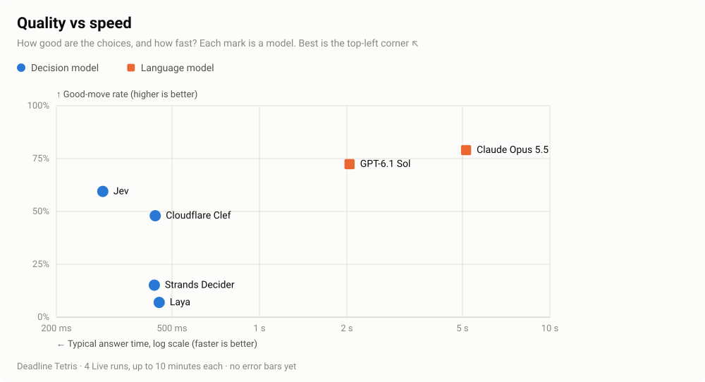
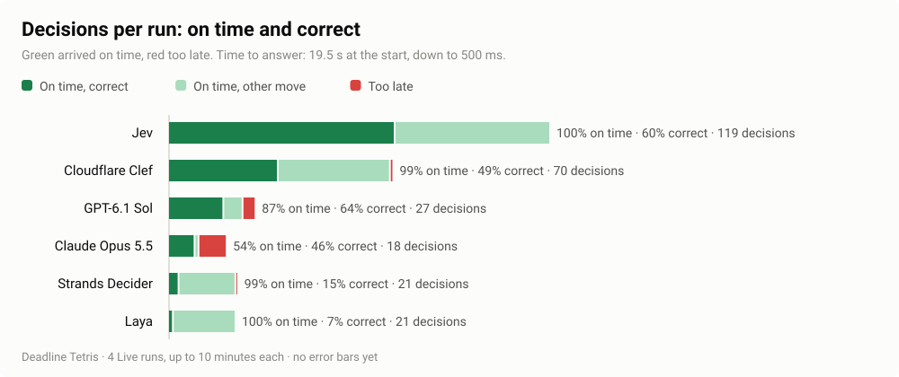

# decision-bench

[](https://github.com/flabdev/decision-bench/actions/workflows/ci.yml)
[](LICENSE)

**Can a model make a good decision fast enough to act on it?**

In a live system, a late answer is as bad as a wrong one. decision-bench measures both: how well a model chooses, and whether its answer arrives in time.

The first **environment** (a game every model plays under the same rules) is **Deadline Tetris**, where each piece keeps falling while the model thinks.

[](docs/media/demo-six-models.mp4)

## Results

### Quality vs speed

<picture>
  <source media="(prefers-color-scheme: dark)" srcset="docs/media/results-choices-dark.svg">
  
</picture>

<br>

<picture>
  <source media="(prefers-color-scheme: dark)" srcset="docs/media/results-decisions-dark.svg">
  
</picture>

**Jev is the only model that is both fast and accurate, so it makes the most correct decisions on time.** The language models choose well but answer too slowly. Laya and Strands Decider answer fast but choose poorly.

<details>
<summary>Full numbers and what they mean</summary>

| Model | Type | On time (higher is better) | Correct (higher is better) | Decisions per run | Good-move rate (higher is better) | Time allowed per decision (median) | Typical answer time (lower is better) | Cost for 4 runs |
|---|---|---|---|---|---|---|---|---|
| Jev | decision model | 100% | 60% | 118.8 | 59% | 4.8 s | 289 ms | $0.03 |
| Cloudflare Clef | decision model | 99% | 49% | 69.8 | 48% | 7.9 s | 438 ms | $0.11 |
| GPT-6.1 Sol | language model | 87% | 64% | 26.8 | 72% | 7.6 s | 2.04 s | $0.48 |
| Claude Opus 5.5 | language model | 54% | 46% | 17.8 | 79% | 8.1 s | 5.14 s | $1.02 |
| Strands Decider | decision model | 99% | 15% | 21.3 | 15% | 10.5 s | 435 ms | self-hosted |
| Laya | decision model | 100% | 7% | 20.5 | 7% | 9.5 s | 452 ms | self-hosted |

- **On time:** the share of the model's decisions that arrived before the piece landed.
- **Correct:** the share that were on time *and* the best spot, as scored by a standard Tetris evaluator.[^grading]
- **Decisions per run:** the pieces the model had to place before its board filled up or the run ended. The longer a model keeps up, the more decisions it makes.
- **Good-move rate:** how often the model picked the best spot, late answers included, so speed doesn't affect it.
- **Time allowed per decision:** how long the piece took to land, which is the deadline for the answer. It starts at 19.5 s and shrinks to 0.5 s as the game speeds up, so a model that keeps up longer faces tighter deadlines.
- **Typical answer time:** the median time from showing the piece to getting the answer.

Four Live runs per model, averaged. Every model played the same four runs, and each run stopped once four of the six boards had filled up.

</details>

[^grading]: The evaluator only looks at the current piece, so a model that plans ahead can lose a point for a better move. Read it as a yardstick, not the truth. [How answers are judged](docs/how-it-works.md#how-each-answer-is-judged).

Recompute everything from the raw logs in [benchmarks/](benchmarks/README.md):

```sh
bun bench chart benchmarks/2026-10-17/tetris --out docs/media/results
bun run stats benchmarks/2026-10-17/tetris/*.jsonl
```

More results, including Claude Haiku 5.5, are on the [results page](docs/results.md). Why each model scores the way it does is in [findings](docs/findings.md).

## How the environment works

1. A piece appears. The model gets the board and a numbered list of every place the piece can land.
2. The model answers with one option.
3. If the answer arrives before the piece lands, the piece goes there. If not, the piece lands wherever it falls.

A **run** is one game from start to finish. Every model plays the same runs, with the same pieces in the same order. In Live runs the answer must arrive before the piece lands: about 20 s at the start, down to 0.5 s as the pieces fall faster every 15 seconds.

| Mode | While the model thinks | What it shows |
|---|---|---|
| **Live** | the piece keeps falling | can the model choose well *and* in time? |
| **Paused** | the game waits (up to 30 s) | can the model choose well at all? |

Every model gets the same pieces, the same prompt and the same options. Rules and timings are in [how it works](docs/how-it-works.md).

## Try it

Needs [Bun](https://bun.sh) 1.4 or later. The demo uses mock models, so it needs no API keys:

```sh
git clone https://github.com/flabdev/decision-bench && cd decision-bench
bun install
bun bench demo
```

To test your own models:

```sh
bun bench init      # creates bench.yaml and .env
bun bench doctor    # checks each model and its key
bun bench run       # plays the runs
bun bench chart runs/bench/<name>    # draws the two charts next to the logs
```

Put your models in `bench.yaml` and their [keys](docs/configuration.md#built-in-models) in `.env`. To watch a run in the browser, start `bun dev` and open http://localhost:5317. Full reference: [docs/bench.md](docs/bench.md).

## Limitations

- **No error bars yet.** Four runs is enough to rank these six models, but not to separate models that score close together.
- **Network time is included.** Every request came from one machine in India, which adds about 0.2–0.3 s.
- **One environment so far.** More are on the [roadmap](#roadmap).

## Roadmap

- **2D reasoning:** a board-only Tetris variant, where the model gets only rotations and columns and has to picture the result.
- **Browser automation:** a second environment, on the same engine.
- **More models and more runs,** with error bars on every number.
- **Published results:** signed result bundles, and a results site with replays.

The design is in [docs/design/eval-engine.md](docs/design/eval-engine.md).

## Documentation

| Page | What's in it |
|---|---|
| [How it works](docs/how-it-works.md) | Rules, timings, the prompt, how answers are judged |
| [Findings](docs/findings.md) | Why each model scores the way it does |
| [Results](docs/results.md) | Every published result, including JevBench |
| [bun bench](docs/bench.md) | Every command and `bench.yaml` setting |
| [Models](docs/models.md) | Adding a model or writing an adapter |
| [Configuration](docs/configuration.md) | Keys, prices and server settings |
| [Self-hosting](docs/self-hosting.md) | Running Laya and Strands Decider on a GPU |
| [Development](docs/development.md) · [API](docs/api.md) | Code layout, tests and the server API |

## Citation

If you use decision-bench, please cite it:

```bibtex
@software{fission2026decisionbench,
  author  = {{Fission Engineering}},
  title   = {decision-bench},
  version = {0.2.0},
  year    = {2026},
  url     = {https://github.com/flabdev/decision-bench}
}
```

Fission Engineering (2026). *decision-bench* (version 0.2.0). https://github.com/flabdev/decision-bench

The same details are in [CITATION.cff](CITATION.cff), which also feeds GitHub's "Cite this repository" button.

## Contributing, security, license

- [CONTRIBUTING.md](CONTRIBUTING.md) lists the checks: `bun run lint && bun run typecheck && bun test`.
- [SECURITY.md](SECURITY.md) covers reporting and how keys are handled.
- [MIT](LICENSE). Third-party models and the [JevBench](https://github.com/fstandhartinger/jevbench) data in `benchmarks/` keep their own terms.
