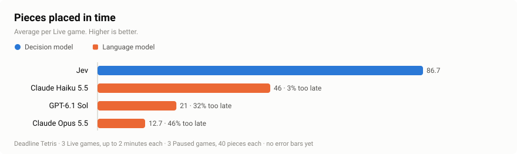

# Results

Every result we have published. The raw logs are in [benchmarks/](../benchmarks/README.md), so you can recompute any number here. The README's charts come from the first section.

- [Live games, six models](#live-games-six-models)
- [Paused and Live games, four models](#paused-and-live-games-four-models)
- [JevBench: decisions on text](#jevbench-decisions-on-text)

## Live games, six models

Four Live games on 2026-10-17. Every model played the same pieces, and each game stopped once four of the six boards had filled up. Laya and Strands Decider ran on our own NVIDIA A10G GPU in AWS us-east-1; every other model ran through its provider's API.

| Model | Type | Pieces placed in time, per game (higher is better) | Games won | Good-move rate (higher is better) | Typical answer time (lower is better) | Answers too late (lower is better) | Cost for 4 games |
|---|---|---|---|---|---|---|---|
| Jev | decision model | **118.8** | **4 of 4** | 59% | **289 ms** | **0%** | $0.03 |
| Cloudflare Clef | decision model | 69.3 | 0 | 48% | 438 ms | <1% | $0.11 |
| GPT-6.1 Sol | language model | 23.3 | 0 | 72% | 2.04 s | 13% | $0.48 |
| Strands Decider | decision model | 21.0 | 0 | 15% | 435 ms | 1% | self-hosted |
| Laya | decision model | 20.5 | 0 | 7% | 452 ms | 0% | self-hosted |
| Claude Opus 5.5 | language model | 9.5 | 0 | **79%** | 5.14 s | 46% | $1.02 |

The language models choose best but answer too slowly for the falling pieces. Laya and Strands Decider answer fast but choose poorly. Jev is the only model that does both.

```sh
bun bench chart benchmarks/2026-10-17/tetris --out docs/media/results
bun run stats benchmarks/2026-10-17/tetris/*.jsonl
```

## Paused and Live games, four models

Run with `bun bench` on 2026-10-28. Each model played 3 Paused games of 40 pieces and 3 Live games of 2 minutes.

<picture>
  <source media="(prefers-color-scheme: dark)" srcset="media/results-2026-10-28-choices-dark.svg">
  
</picture>

<picture>
  <source media="(prefers-color-scheme: dark)" srcset="media/results-2026-10-28-pieces-dark.svg">
  
</picture>

| Model | Type | Good-move rate, Paused (higher is better) | Lines in 40 pieces, Paused (higher is better) | Typical answer time (lower is better) | Pieces placed in time, Live (higher is better) | Answers too late, Live (lower is better) | Cost for 6 games |
|---|---|---|---|---|---|---|---|
| Jev | decision model | 50% | 8.0 | 281 ms | **86.7** | **0%** | $0.03 |
| Claude Haiku 5.5 | language model | 54% | 12.3 | 1.9 s | 46.0 | 3% | $0.07 |
| GPT-6.1 Sol | language model | 69% | 12.3 | 2.4 s | 21.0 | 32% | $0.95 |
| Claude Opus 5.5 | language model | **78%** | **12.7** | 5.8 s | 12.7 | 46% | $3.44 |

When the game waits for them, the slower models choose better. In Live games, more of their answers arrive after the piece has landed, so they place fewer pieces.

```sh
bun bench chart benchmarks/2026-10-28/bench --out docs/media/results-2026-10-28
bun run stats benchmarks/2026-10-28/bench/*.jsonl
```

## JevBench: decisions on text

[JevBench](https://github.com/fstandhartinger/jevbench) (v1.0.0) is an independent benchmark for decision models: 231 public questions about short texts (yes or no, pick one, rate on a scale), in three levels of difficulty. It shows whether a weak Tetris score means a weak model, or only a poor fit for Tetris. Each model answered every question once, on 2026-10-17.

| Model | Accuracy (higher is better) | Easy | Original | Hard | Median time | Cost per 1,000 decisions |
|---|---|---|---|---|---|---|
| GPT-6.1 Sol | **99.6%** | 48/48 | 72/72 | 110/111 | 1.7 s | $2.12 |
| Claude Opus 5.5 | **99.6%** | 48/48 | 72/72 | 110/111 | 2.5 s | $10.01 |
| Cloudflare Clef | 87.9% | 48/48 | 71/72 | 84/111 | 393 ms | $0.17 |
| Jev | 86.1% | 48/48 | 71/72 | 80/111 | 297 ms | $0.04 |
| Strands Decider | 77.9% | 48/48 | 67/72 | 65/111 | 516 ms | self-hosted |
| Laya | 53.7% | 47/48 | 47/72 | 30/111 | 473 ms | self-hosted |

Given time, the language models answer almost everything correctly. The decision models give up some accuracy to answer in a few hundred milliseconds, which is what the falling pieces reward. Why each model scores the way it does is in [findings](findings.md).
